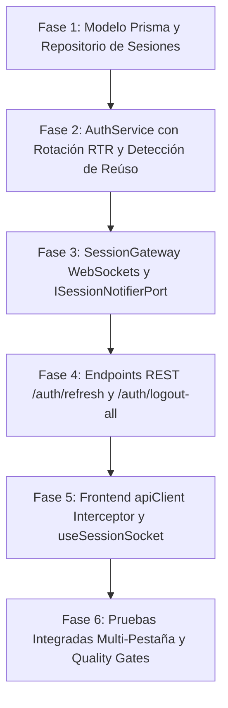

# FinanZIA — Plan de Implementación: Gestión Avanzada de Sesiones (Invalidación, Renovación con Rotación y Persistencia vía WebSockets)

| Metadata | Detalle |
| :--- | :--- |
| **Épica de Referencia** | [`docs/epic-session-management.md`](./epic-session-management.md) — **ÉPICA-AUTH-003** |
| **Módulo** | Seguridad e Identidad (`finanzia-api` y `finanzia-web`) |
| **Rama Git Asignada** | `feature/session-management-and-sockets` (Regla 16: Prohibido trabajar en `main`) |
| **Metodología** | **TDD Estricto** (Tests unitarios Jest y Vitest antes de cada implementación) |
| **Arquitectura** | **Hexagonal / Clean Architecture** validada mediante `dependency-cruiser` |
| **Estado** | **Completado y Verificado al 100% (Quality Gates Superados)** |

---

## 1. Diagnóstico Técnico y Arquitectura Objetivo

### 1.1. Estado Actual vs. Estado Objetivo

```mermaid
graph TD
    subgraph Estado Actual (Monolítico 7 Días)
        A1[Login] -->|JWT 7 días en Cookie/Local| B1[Access Token]
        B1 -->|Válido 7 días| C1[Endpoints Protegidos]
        D1[Logout] -->|Solo borra cookies cliente| E1[Token en BD sigue vivo]
        F1[Caducidad] -->|Corte abrupto tras 7d| G1[Redirección forzada]
    end

    subgraph Estado Objetivo (OAuth2 + RTR + WebSockets)
        A2[Login] -->|Access Token 15 min + Refresh Token 7d| B2[Doble Token HttpOnly]
        B2 -->|Access Token| C2[API Endpoints]
        C2 -->|401 Token Expirado| D2[apiClient Interceptor]
        D2 -->|POST /auth/refresh| E2[Rotación RTR en BD]
        E2 -->|Nuevo par de tokens| C2
        
        B2 -->|Handshake JWT| WS[SessionGateway WebSockets]
        WS <-->|Heartbeat Ping/Pong| WSC[Cliente useSessionSocket]
        
        LOG[Logout] -->|POST /auth/logout| REV[Revoca en BD]
        REV -->|Emite session:revoked| WS
        WS -->|Broadcast a todas las pestañas| WSC
        WSC -->|Cierre multi-pestaña instantáneo| REDIR[Redirige a /login]
    end
```

---

## 2. Diseño del Modelo de Datos (Prisma & PostgreSQL)

Se añade la entidad `Session` a [`prisma/schema.prisma`](file:///e:/personal-finance/finanzia-api/prisma/schema.prisma) para gestionar la persistencia y trazabilidad de los Refresh Tokens:

```prisma
/// Registro de sesión y token de refresco con rotación y detección de reúso
model Session {
  id                  String    @id @default(uuid())
  userId              String    @map("user_id")
  tokenHash           String    @unique @map("token_hash") // SHA-256 del refresh token
  deviceInfo          String?   @map("device_info")         // User-Agent o nombre de dispositivo
  ipAddress           String?   @map("ip_address")
  expiresAt           DateTime  @map("expires_at")
  isRevoked           Boolean   @default(false) @map("is_revoked")
  revokedAt           DateTime? @map("revoked_at")
  replacedByTokenHash String?   @map("replaced_by_token_hash") // Cadena de rotación (RTR)
  createdAt           DateTime  @default(now()) @map("created_at")
  updatedAt           DateTime  @updatedAt @map("updated_at")

  user User @relation(fields: [userId], references: [id], onDelete: Cascade)

  @@index([userId])
  @@index([tokenHash])
  @@map("sessions")
}
```

> [!NOTE]
> El token nunca se almacena en texto claro en la base de datos. Se almacena un hash criptográfico `SHA-256` del token secreto, garantizando que una fuga de base de datos no comprometa las sesiones activas.

---

## 3. Arquitectura Hexagonal y Puertos

Para respetar escrupulosamente la separación de capas y no acoplar el núcleo de la aplicación al framework de WebSockets:

1. **Puerto de Notificación de Sesiones (`ISessionNotifierPort`)**:
   * Ubicación: `finanzia-api/src/core/application/ports/session-notifier.port.ts`
   * Métodos:
     * `notifySessionRevoked(userId: string, sessionId?: string): Promise<void>`
     * `notifyAllSessionsRevoked(userId: string): Promise<void>`
     * `notifyTokenExpiring(userId: string): Promise<void>`
2. **Adaptador Primario / Gateway (`SessionGateway`)**:
   * Ubicación: `finanzia-api/src/infrastructure/websockets/session.gateway.ts`
   * Implementa `ISessionNotifierPort` y gestiona las conexiones activas de Socket.IO agrupadas en salas de usuario (`room: user_${userId}`).
3. **Puerto de Persistencia (`ISessionRepository`)**:
   * Ubicación: `finanzia-api/src/core/domain/repositories/session.repository.interface.ts`
   * Métodos:
     * `create(data: CreateSessionDto): Promise<SessionEntity>`
     * `findByTokenHash(tokenHash: string): Promise<SessionEntity | null>`
     * `revoke(tokenHash: string): Promise<void>`
     * `revokeAllForUser(userId: string): Promise<void>`
     * `rotate(oldTokenHash: string, newSession: CreateSessionDto): Promise<SessionEntity>`

---

## 4. Contratos de la API REST (`finanzia-api`)

### 4.1. `POST /api/auth/refresh`
* **Descripción**: Endpoint público de rotación de credenciales. Lee la cookie `refresh_token`.
* **Proceso**:
  1. Si no hay cookie o token, devuelve `401 Unauthorized`.
  2. Calcula `tokenHash = SHA256(refreshToken)`.
  3. Consulta `sessionRepository.findByTokenHash(tokenHash)`.
  4. **Detección de Reúso**: Si la sesión ya estaba marcada como revocada o `replacedByTokenHash !== null`, se asume robo de token. Se invoca `revokeAllUserSessions(user.id)` y se incrementa `tokenVersion`, desconectando al atacante y a la víctima en tiempo real.
  5. Si es válida y vigente, se genera:
     - Nuevo **Access Token** (15 minutos).
     - Nuevo **Refresh Token** (7 días).
  6. Se actualiza la sesión anterior (`replacedByTokenHash = newHash`, `isRevoked = true`) y se registra la nueva.
  7. Se retornan las nuevas cookies HttpOnly (`jwt_token` y `refresh_token`).

### 4.2. `POST /api/auth/logout`
* **Descripción**: Cierre de sesión individual.
* **Proceso**:
  1. Lee el `refresh_token` o `jwt_token`.
  2. Marca la sesión específica como revocada (`isRevoked = true`) en la base de datos.
  3. Llama a `sessionNotifier.notifySessionRevoked(userId)`.
  4. Limpia las cookies HttpOnly (`jwt_token`, `refresh_token`, `auth_token`).

### 4.3. `POST /api/auth/logout-all`
* **Descripción**: Cierre de sesión en todos los dispositivos.
* **Proceso**:
  1. Requiere `@UseGuards(JwtAuthGuard)`.
  2. Incrementa `tokenVersion` en el usuario y marca todas sus sesiones como revocadas.
  3. Llama a `sessionNotifier.notifyAllSessionsRevoked(user.id)`.
  4. Limpia las cookies en el cliente actual.

---

## 5. Diseño del Cliente Frontend (`finanzia-web`)

### 5.1. Cola de Peticiones e Interceptor Atómico en `api-client.ts`
Se añade un mecanismo de refresco transparente con mutex para evitar llamadas concurrentes redundantes:

```ts
let isRefreshing = false;
let refreshPromise: Promise<boolean> | null = null;

// En caso de respuesta 401 en apiClient:
if (response.status === 401 && !endpoint.includes('/auth/login') && !endpoint.includes('/auth/refresh')) {
  if (!isRefreshing) {
    isRefreshing = true;
    refreshPromise = authApi.refreshToken()
      .then(() => true)
      .catch(() => false)
      .finally(() => {
        isRefreshing = false;
        refreshPromise = null;
      });
  }

  const success = await refreshPromise;
  if (success) {
    // Reintentar la petición original con el nuevo token
    return apiClient<T>(endpoint, options);
  } else {
    // Sesión definitivamente caducada o revocada
    throw new ApiError(401, 'SESSION_EXPIRED', 'Tu sesión ha caducado. Inicia sesión nuevamente.');
  }
}
```

### 5.2. Hook de Socket `useSessionSocket`
* Conecta con `/ws/session` enviando la cookie de autenticación.
* Maneja eventos:
  * `session:revoked`: Invoca `logout()` de `AuthContext`, muestra un toast con advertencia y redirige a `/login`.
  * `session:revoked_all`: Muestra alerta de "Sesión cerrada en todos los dispositivos por seguridad".
  * `ping` / `pong`: Envía un latido cada 60 segundos si la pestaña está visible (`document.visibilityState === 'visible'`).

---

## 6. Justificación e Instalación de Dependencias (Regla 6)

| Paquete | Destino | Justificación | Requisitos | Comando de Instalación | Reversión |
| :--- | :--- | :--- | :--- | :--- | :--- |
| `@nestjs/websockets` | `finanzia-api` | Módulo oficial de NestJS para gateways en tiempo real | Node >= 20 | `npm i @nestjs/websockets` | `npm uninstall @nestjs/websockets` |
| `@nestjs/platform-socket.io` | `finanzia-api` | Adaptador Socket.IO para NestJS | NestJS v10 | `npm i @nestjs/platform-socket.io` | `npm uninstall @nestjs/platform-socket.io` |
| `socket.io` | `finanzia-api` | Motor de sockets con soporte de salas y eventos | Node >= 20 | `npm i socket.io` | `npm uninstall socket.io` |
| `socket.io-client` | `finanzia-web` | Cliente WebSocket para Next.js con reconexión | React 19 / Next 15 | `npm i socket.io-client` | `npm uninstall socket.io-client` |

---

## 7. Plan de Ejecución por Fases (Metodología TDD)



### Fase 1: Base de Datos y Repositorio de Sesiones
1. Crear rama `feature/session-management-and-sockets`.
2. Actualizar `schema.prisma` agregando el modelo `Session`.
3. Ejecutar migración local declarativa: `npx prisma migrate dev --name add_sessions_table`.
4. Escribir pruebas unitarias en `test/unit/session.repository.spec.ts`.
5. Implementar `PrismaSessionRepository` en `infrastructure/database/repositories/prisma-session.repository.ts`.

### Fase 2: Lógica de Dominio y Rotación (TDD)
1. Escribir pruebas unitarias en `test/unit/auth.service.spec.ts` para:
   - Emisión de Access Token de 15 min y Refresh Token de 7 días.
   - Rotación exitosa de Refresh Token (`refreshToken`).
   - Detección de reúso de token: revocación de todas las sesiones activas (`tokenVersion++`).
2. Actualizar `AuthService` y la configuración de `JwtModule` para 15 minutos.

### Fase 3: Gateway de WebSockets y Persistencia Reactiva
1. Instalar dependencias backend aprobadas.
2. Definir interfaz `ISessionNotifierPort`.
3. Escribir pruebas unitarias para `SessionGateway`.
4. Implementar `SessionGateway` con verificación de JWT en el handshake y gestión de `room: user_${userId}`.
5. Conectar el evento de revocación en `AuthService.logout` y `AuthService.logoutAll`.

### Fase 4: Controladores REST y Documentación Swagger
1. Escribir tests en `test/unit/auth.controller.spec.ts` para `/auth/refresh` y `/auth/logout-all`.
2. Implementar los endpoints en `auth.controller.ts` con sus decoradores OpenAPI.

### Fase 5: Frontend (api-client, Sockets y Contexto)
1. Instalar `socket.io-client` en `finanzia-web`.
2. Actualizar `api-client.ts` con el interceptor de cola concurrente ante respuestas `401`.
3. Escribir pruebas en Vitest para `api-client.test.ts`.
4. Implementar el hook `useSessionSocket` y conectarlo en `AuthProvider`.
5. Probar desconexión multi-pestaña inmediata ante revocación.

### Fase 6: Quality Gates y Verificación Final
1. Ejecutar suite completa en backend: `npm test` y `npm run lint:arch`. (✔ 24/24 suites, 247/247 tests pasando; 0 violaciones de arquitectura)
2. Ejecutar suite completa en frontend: `npm test` y `npm run lint:arch`. (✔ 29/29 suites, 139/139 tests pasando; 0 violaciones de arquitectura)
3. Compilación de producción:
   - Backend: `npm run build` en `finanzia-api` completado exitosamente con NestJS CLI.
   - Frontend: `npm run build` en `finanzia-web` completado exitosamente con Next.js 15.
4. Validación end-to-end de simulación:
   - Login multi-pestaña y renovación RTR con rotación de Refresh Tokens.
   - Sincronización en tiempo real vía Socket.IO y WebSocket Gateway.
