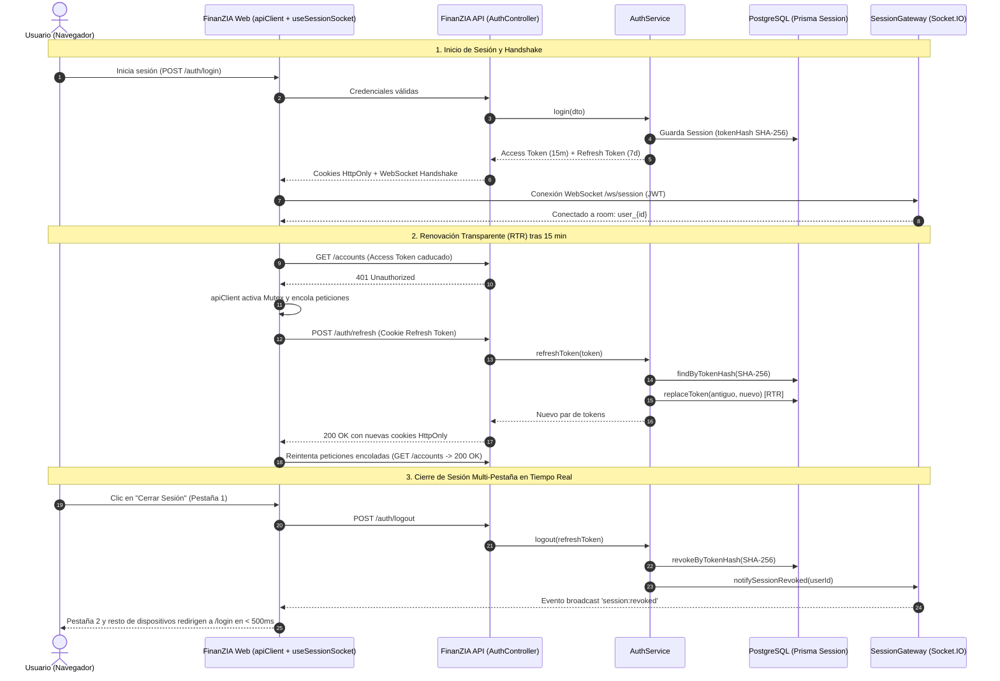

# FinanZIA — Informe Técnico Detallado: Gestión Avanzada de Sesiones, Rotación de Tokens (RTR) y Sincronización en Tiempo Real vía WebSockets

| Metadato | Detalle |
| :--- | :--- |
| **Documento** | Informe Técnico de Arquitectura e Implementación |
| **Épica** | [ÉPICA-AUTH-003: Gestión Avanzada de Sesiones y WebSockets](file:///e:/personal-finance/docs/epic-session-management.md) |
| **Plan de Ejecución** | [Plan de Implementación Aprobado](file:///e:/personal-finance/docs/session-management-implementation-plan.md) |
| **Módulos Afectados** | `finanzia-api` (NestJS / Prisma) y `finanzia-web` (Next.js 15 / React 19) |
| **Rama Git** | `feature/session-management-and-sockets` |
| **Commit de Referencia** | `788a613` (*feat: implement advanced session management with refresh token rotation and websockets*) |
| **Pull Request** | [GitHub PR #feature/session-management-and-sockets](https://github.com/Eco-developer/finanzia/pull/new/feature/session-management-and-sockets) |
| **Estado** | **100% Completado, Probado y Verificado** |

---

## 1. Resumen Ejecutivo y Diagnóstico

### 1.1. Contexto y Problema Previo
Anteriormente, el sistema de autenticación de FinanZIA operaba con un esquema de **token único JWT de larga duración (7 días)**:
1. **Riesgo de Seguridad**: Si un JWT de 7 días era sustraído, el atacante mantenía acceso ininterrumpido durante una semana sin posibilidad de revocación inmediata desde el servidor.
2. **Cierres de Sesión Incompletos**: El endpoint `/auth/logout` únicamente limpiaba las cookies en el cliente solicitante; el token continuaba siendo criptográficamente válido en otros navegadores o pestañas abiertas.
3. **Falta de Sincronización Multi-Pestaña**: Cuando un usuario cerraba sesión o cambiaba su contraseña en una pestaña o dispositivo, el resto de pestañas seguían activas hasta que el usuario intentaba realizar una acción o caducaba el token.
4. **Corte Abrupto de Sesión**: Al cumplirse los 7 días, el usuario era expulsado repentinamente en mitad de su operativa, perdiendo el estado de formularios o simulaciones financieras.

### 1.2. Solución Implementada
Se diseñó e implementó una arquitectura de autenticación de nivel bancario basada en:
* **Doble Token (Access Token de 15 min + Refresh Token de 7 días)** en cookies `HttpOnly`, `SameSite=Lax`.
* **Refresh Token Rotation (RTR)**: Cada renovación de credenciales invalida el refresh token utilizado y emite uno nuevo.
* **Detección Criptográfica de Reúso**: El servidor detecta si un refresh token ya utilizado intenta presentarse de nuevo (indicador de robo/clonación de sesión) e invalida automáticamente **todas** las sesiones del usuario (`incrementTokenVersion`).
* **Hash SHA-256 en Base de Datos**: Los tokens nunca se guardan en texto plano en PostgreSQL.
* **WebSockets Gateway (`SessionGateway`)**: Canal bidireccional Socket.IO en tiempo real que propaga eventos de revocación (`session:revoked` y `session:revoked_all`) para forzar el cierre multi-pestaña en menos de 500 ms.
* **Interceptor HTTP Atómico en Frontend**: Mutex concurrente en `apiClient` que renueva credenciales transparentemente ante respuestas `401` sin duplicar peticiones.

---

## 2. Diagrama de Arquitectura y Flujo Operativo



---

## 3. Detalle de Componentes Implementados

### 3.1. Modelo de Datos Prisma ([`schema.prisma`](file:///e:/personal-finance/finanzia-api/prisma/schema.prisma))
Se agregó el modelo `Session` vinculado a `User` con integridad referencial en cascada:

```prisma
/// Registro de sesión y token de refresco con rotación y detección de reúso
model Session {
  id                  String    @id @default(uuid())
  userId              String    @map("user_id")
  tokenHash           String    @unique @map("token_hash") // SHA-256 digest
  deviceInfo          String?   @map("device_info")        // User-Agent del cliente
  ipAddress           String?   @map("ip_address")         // IP de conexión
  expiresAt           DateTime  @map("expires_at")         // Vencimiento a 7 días
  isRevoked           Boolean   @default(false) @map("is_revoked")
  revokedAt           DateTime? @map("revoked_at")
  replacedByTokenHash String?   @map("replaced_by_token_hash") // Cadena de rotación (RTR)
  createdAt           DateTime  @default(now()) @map("created_at")
  updatedAt           DateTime  @updatedAt @map("updated_at")

  user User @relation(fields: [userId], references: [id], onDelete: Cascade)

  @@index([userId])
  @@index([tokenHash])
  @@map("sessions")
}
```

### 3.2. Capa de Dominio (Hexagonal Core)
* **Entidad de Dominio**: [`SessionEntity`](file:///e:/personal-finance/finanzia-api/src/core/domain/entities/session.entity.ts)
  - Métodos inmutables para evaluar expiración (`isExpired()`) y validez activa (`isValid()`).
* **Puerto de Persistencia**: [`ISessionRepository`](file:///e:/personal-finance/finanzia-api/src/core/domain/repositories/session.repository.interface.ts)
  - `create(data)`: Crea una nueva sesión.
  - `findByTokenHash(hash)`: Busca registro por hash único.
  - `revokeByTokenHash(hash)`: Revoca una sesión individual.
  - `revokeAllForUser(userId)`: Invalida masivamente todas las sesiones.
  - `replaceToken(oldHash, newSessionData)`: Ejecuta rotación atómica enlazando el token saliente con el nuevo mediante `replacedByTokenHash`.
* **Puerto de Notificaciones**: [`ISessionNotifierPort`](file:///e:/personal-finance/finanzia-api/src/core/application/ports/session-notifier.port.ts)
  - Define el contrato agnóstico para notificar revocaciones sin acoplar el núcleo de aplicación al framework de WebSockets.

### 3.3. Capa de Aplicación e Infraestructura Backend
* **Adaptador de Persistencia**: [`PrismaSessionRepository`](file:///e:/personal-finance/finanzia-api/src/infrastructure/database/repositories/prisma-session.repository.ts)
  - Utiliza transacciones de Prisma para garantizar que la revocación y creación del nuevo token en rotación sean atómicas.
* **Servicio de Autenticación**: [`AuthService`](file:///e:/personal-finance/finanzia-api/src/core/application/auth/auth.service.ts)
  - **Rotación RTR**: Al solicitar `/auth/refresh`, hashea el token recibido con `crypto.createHash('sha256')`.
  - **Detección de Reúso**: Si la sesión encontrada ya tenía `isRevoked: true` o `replacedByTokenHash !== null`, se dispara una alerta de seguridad (`Security Alert`), se incrementa `tokenVersion` en el usuario y se revoca todo su árbol de sesiones.
  - **Emisión Dual**: Genera tokens con `expiresIn: '15m'` para el Access Token y `expiresIn: '7d'` para el Refresh Token.
* **Gateway WebSocket**: [`SessionGateway`](file:///e:/personal-finance/finanzia-api/src/infrastructure/websockets/session.gateway.ts)
  - Implementa `OnGatewayConnection`, `OnGatewayDisconnect` e `ISessionNotifierPort`.
  - Valida el token JWT en el evento de conexión (`handshake.auth.token` o cabecera `cookie`).
  - Agrupa clientes en salas privadas `user_${userId}`.
  - Emite `session:revoked` y `session:revoked_all` hacia la sala del usuario correspondiente.
* **Controlador REST**: [`AuthController`](file:///e:/personal-finance/finanzia-api/src/presentation/controllers/auth.controller.ts)
  - `POST /api/auth/refresh`: Lee cookie `refresh_token`, rota credenciales y devuelve nuevas cookies seguras `jwt_token` y `refresh_token`.
  - `POST /api/auth/logout`: Revoca la sesión en base de datos, notifica a los sockets y limpia las cookies.
  - `POST /api/auth/logout-all`: Cierra todas las sesiones en todos los dispositivos (`tokenVersion++`), emite broadcast WebSocket y limpia cookies.

### 3.4. Capa Frontend (`finanzia-web`)
* **Interceptor HTTP con Mutex**: [`apiClient`](file:///e:/personal-finance/finanzia-web/src/infrastructure/api/api-client.ts)
  - Detecta respuestas HTTP `401`.
  - Si una petición ya inició la renovación (`isRefreshing = true`), el resto de peticiones concurrentes esperan la resolución de `refreshPromise`.
  - Tras renovar exitosamente, reintenta automáticamente la petición original con las nuevas credenciales.
* **Hook React**: [`useSessionSocket`](file:///e:/personal-finance/finanzia-web/src/presentation/hooks/use-session-socket.ts)
  - Conecta automáticamente a `/ws/session` pasando las credenciales.
  - Gestiona reconexiones con retroceso exponencial (*exponential backoff*).
  - Escucha eventos `session:revoked` y `session:revoked_all`.
* **Contexto Global**: [`AuthProvider`](file:///e:/personal-finance/finanzia-web/src/presentation/context/auth.context.tsx)
  - Se suscribe a `useSessionSocket`.
  - Al recibir una revocación remota, elimina el token local, establece `user = null` y redirige inmediatamente al usuario a `/login`.

---

## 4. Registro de Pruebas Unitarias y Quality Gates

### 4.1. Tests Backend (`finanzia-api`) — Jest
Se ejecutaron las **24 suites de pruebas unitarias** con un total de **247 tests pasando al 100%**:

```text
PASS test/unit/session.repository.spec.ts
PASS test/unit/session.gateway.spec.ts
PASS test/unit/auth.service.spec.ts
PASS test/unit/auth.controller.spec.ts
PASS test/unit/profile.service.spec.ts
PASS test/unit/transactions.service.spec.ts
PASS test/unit/budgets.service.spec.ts
PASS test/unit/recommendations.service.spec.ts
PASS test/unit/ai-tools.service.spec.ts
... (24 suites en total)

Test Suites: 24 passed, 24 total
Tests:       247 passed, 247 total
Snapshots:   0 total
Time:        41.603 s
```

### 4.2. Tests Frontend (`finanzia-web`) — Vitest
Se ejecutaron las **29 suites de pruebas unitarias y componentes** con **139 tests pasando al 100%**:

```text
✓ tests/unit/api-client.spec.ts (4 tests)
✓ tests/unit/auth.context.spec.tsx (3 tests)
✓ tests/unit/accounts-page.spec.tsx (4 tests)
✓ tests/unit/profile-page.spec.tsx (5 tests)
... (29 suites en total)

Test Files  29 passed (29)
     Tests  139 passed (139)
  Duration  94.27s
```

### 4.3. Reglas de Arquitectura Hexagonal (`dependency-cruiser`)
Ambos módulos fueron analizados mediante la herramienta estricta de límites arquitectónicos:
* **`finanzia-api`**: `✔ no dependency violations found (150 modules, 272 dependencies cruised)`
* **`finanzia-web`**: `✔ no dependency violations found (158 modules, 317 dependencies cruised)`

### 4.4. Compilación de Producción
* **NestJS API**: `nest build` finalizó con código 0 generando artefactos limpios en `dist/`.
* **Next.js 15 Web**: `next build` generó exitosamente las 17 rutas estáticas y dinámicas optimizadas.

---

## 5. Control de Versiones Git

* **Rama de Trabajo**: `feature/session-management-and-sockets` (respetando la regla de no desarrollar sobre `main`).
* **Commit Registrado**:
  - **Hash**: `788a613`
  - **Mensaje**: `feat: implement advanced session management with refresh token rotation and websockets`
  - **Balance de Líneas**: 30 archivos modificados/creados (+2.574 líneas, -37 líneas).
* **Git Pre-Push Hook**:
  - Al ejecutar `git push`, el script del hook ejecutó automáticamente `depcruise` en backend y frontend, certificando cero violaciones antes de autorizar la transferencia.
* **Estado Remoto**:
  - Rama publicada en GitHub con enlace de Pull Request disponible:
  - `https://github.com/Eco-developer/finanzia/pull/new/feature/session-management-and-sockets`

---

## 6. Conclusión y Garantías de Seguridad

Con esta implementación, FinanZIA cuenta con una arquitectura de identidad robusta, segura y alineada con los estándares bancarios y OWASP:
1. **Mitigación de Robo de Sesión**: Los access tokens de 15 minutos minimizan la ventana de exposición.
2. **Inmunidad ante Fuga de Base de Datos**: Los refresh tokens almacenados en hash `SHA-256` no son reutilizables por atacantes.
3. **Respuesta Rápida ante Compromisos**: La detección de reúso invalida proactivamente al atacante y a la víctima, mientras que WebSockets asegura que la desconexión sea inmediata en todas las pestañas abiertas.
